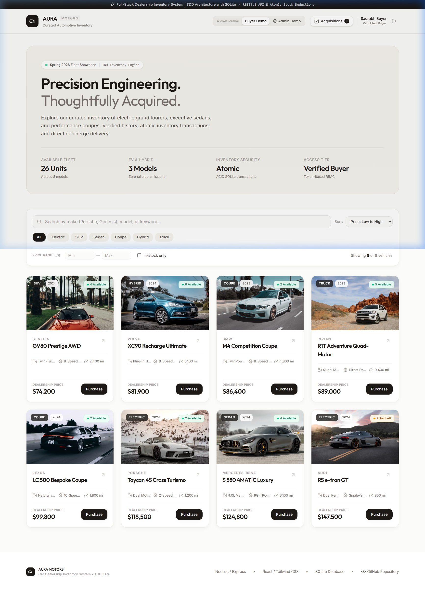
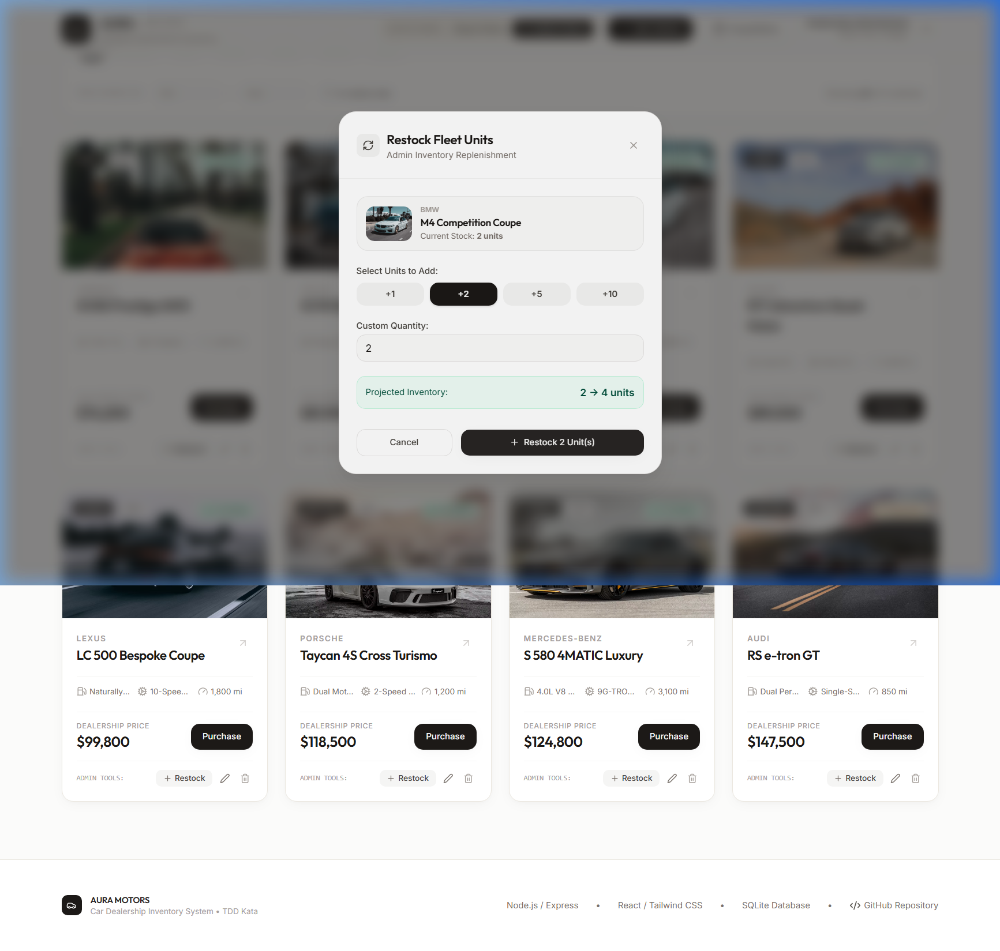

# AURA Motors — Car Dealership Inventory System

[](https://github.com/SaurabhCodes-16/car-dealership-inventory/actions)
[](https://github.com/SaurabhCodes-16/car-dealership-inventory)
[](https://opensource.org/licenses/MIT)
[](https://www.typescriptlang.org/)
[](https://react.dev/)
[](https://tailwindcss.com/)
[-indigo.svg)](https://www.sqlite.org/)

A full-stack, enterprise-grade **Car Dealership Inventory System** built according to Test-Driven Development (TDD) best practices. Features a secure RESTful API with token-based authentication (JWT) and Role-Based Access Control (RBAC), atomic database inventory transactions, and a luxury single-page application (SPA) with a calm, tactile aesthetic.

**Public Repository**: [https://github.com/SaurabhCodes-16/car-dealership-inventory](https://github.com/SaurabhCodes-16/car-dealership-inventory)

---

## Application Showcase

### 1. Fleet Showcase & Dynamic Catalog
A calm editorial interface with responsive vehicle cards, real-time stock pills, live keyword search, category filters, and price range sliders:



---

### 2. Vehicle Acquisition & Checkout Modal
Atomic stock deduction flow displaying detailed vehicle specifications, dealer documentation breakdown, and immediate transaction confirmation:


---

### 3. Administrator Fleet Restock Portal
Admin-exclusive inventory replenishment interface with quick incremental unit selectors and live projected inventory computation:



---

## Architectural Overview

The application is structured into decoupled frontend and backend layers with persistent file-backed SQLite storage:

```
car-dealership-inventory/
├── backend/                        # Node.js + Express + TypeScript + SQLite
│   ├── src/
│   │   ├── config/                 # SQLite connection (WAL mode), migrations & seeds
│   │   ├── controllers/            # Auth and Vehicle request handlers
│   │   ├── middleware/             # JWT verification, RBAC guards, centralized error handler
│   │   ├── models/                 # TypeScript entity definitions
│   │   ├── repositories/           # SQLite atomic transaction queries
│   │   ├── routes/                 # Express REST endpoints
│   │   ├── validators/             # Zod input schemas
│   │   ├── app.ts                  # Express application setup
│   │   └── server.ts               # HTTP server bootstrap
│   ├── tests/                      # Jest & Supertest TDD test suites
│   │   ├── auth.test.ts            # Registration, login, duplicate email handling
│   │   ├── vehicles.test.ts        # CRUD, multi-criteria search, admin delete guards
│   │   └── inventory.test.ts       # Atomic purchase, out-of-stock rejection, restock
│   ├── jest.config.js
│   ├── tsconfig.json
│   └── package.json
├── frontend/                       # React 19 + TypeScript + Vite + Tailwind CSS
│   ├── src/
│   │   ├── components/             # Reusable UI components (Navbar, Cards, Modals, Toasts)
│   │   ├── context/                # AuthContext (RBAC) & InventoryContext (Catalog state)
│   │   ├── services/               # Axios client with JWT auto-injection
│   │   ├── types/                  # Shared UI types & data contracts
│   │   ├── index.css               # Luxury color tokens & smooth spring transitions
│   │   ├── App.tsx                 # Main SPA orchestrator
│   │   └── main.tsx
│   ├── index.html
│   ├── tailwind.config.js
│   └── vite.config.ts
├── docs/
│   ├── screenshots/                # Showcase imagery
│   └── AI_Kata_Car_Dealership_Inventory_System_V2.pdf
├── package.json                    # Monorepo concurrent runner
├── PROMPTS.md                      # Complete AI prompt & architecture interaction records
└── README.md
```

---

## Core Features & Business Logic

### 1. Robust RESTful Backend API
- **Token-Based Authentication (JWT)**: Secure user registration and login with bcrypt password hashing (10 salt rounds) and 7-day token issuance.
- **Role-Based Access Control (RBAC)**: Distinguishes between `customer` (verified buyers) and `admin` (dealership managers). Sensitive routes (vehicle creation, restock, and deletion) are locked behind `requireAdmin` middleware.
- **Atomic Transactions (ACID)**: Vehicle purchase and restock queries execute inside `db.transaction()` blocks using `better-sqlite3`. Guarantees zero race conditions during simultaneous acquisitions.
- **Out-of-Stock Safeguards**: Purchases are rejected at the database query level with an explicit `400 Bad Request` if `quantity <= 0`.
- **Search & Filtering Engine**: Parameterized SQL queries allow searching by make (partial match), model, category, and minimum/maximum price boundaries.

### 2. Luxury Single-Page Application (SPA)
- **Calm, High-End Design System**: Uses warm porcelain (`#FBFBFA`), deep stone obsidian (`#1C1917`), and subtle champagne gold badges. Completely avoids generic AI neon/purple gradients.
- **Smooth Micro-Interactions**: Custom cubic-bezier spring curves (`cubic-bezier(0.16, 1, 0.3, 1)`) for subtle hover animations and modal transitions.
- **Live Search & Filter**: Filter instantly by keyword, category tabs (Electric, SUV, Sedan, Coupe, Hybrid, Truck), price boundaries, and in-stock only.
- **Disabled Zero-Stock State**: When a vehicle reaches 0 stock, the card displays a "Sold Out" badge and the purchase button is physically disabled with explanatory text.
- **1-Click Demo Account Switcher**: Easily test both customer and manager permissions directly from the navigation bar without manually typing credentials:
  - **Buyer Demo**: `buyer@dealership.com` / `buyer123`
  - **Admin Demo**: `admin@dealership.com` / `admin123`

---

## API Specification

### Authentication Endpoints
| Method | Endpoint | Access | Description |
|---|---|---|---|
| `POST` | `/api/auth/register` | Public | Register new customer or admin user |
| `POST` | `/api/auth/login` | Public | Authenticate user and receive JWT token |
| `GET` | `/api/auth/me` | Protected | Fetch currently authenticated user profile |

### Vehicles & Inventory Endpoints
| Method | Endpoint | Access | Description |
|---|---|---|---|
| `GET` | `/api/vehicles` | Protected | View list of all available vehicles |
| `GET` | `/api/vehicles/search` | Protected | Multi-criteria search (`make`, `model`, `category`, `minPrice`, `maxPrice`, `inStockOnly`) |
| `POST` | `/api/vehicles` | Protected | Add a new vehicle to dealership inventory |
| `GET` | `/api/vehicles/:id` | Protected | Retrieve full specifications for a single vehicle |
| `PUT` | `/api/vehicles/:id` | Protected | Update vehicle details, pricing, or specifications |
| `DELETE` | `/api/vehicles/:id` | **Admin Only** | Remove vehicle permanently from catalog |
| `POST` | `/api/vehicles/:id/purchase` | Protected | Purchase vehicle; atomically decrements quantity by 1 |
| `POST` | `/api/vehicles/:id/restock` | **Admin Only** | Restock vehicle; increases quantity by specified amount |
| `GET` | `/api/vehicles/purchases/me` | Protected | View purchase history and acquisition receipts |

---

## Local Setup & Quick Start

### Prerequisites
- **Node.js**: v18.0.0 or higher (v22.x recommended)
- **npm**: v9.0.0 or higher
- **Git**

### Installation

1. **Clone the repository**:
   ```bash
   git clone https://github.com/SaurabhCodes-16/car-dealership-inventory.git
   cd car-dealership-inventory
   ```

2. **Install all dependencies**:
   ```bash
   # Install root concurrent dev runner
   npm install

   # Install backend dependencies
   cd backend && npm install

   # Install frontend dependencies
   cd ../frontend && npm install
   cd ..
   ```

3. **Run the Automated Test Suite (TDD Verification)**:
   ```bash
   cd backend
   npm test
   ```

4. **Start Backend & Frontend Concurrently**:
   From the repository root:
   ```bash
   npm run dev
   ```

   Alternatively, launch in separate terminals:
   ```bash
   # Terminal 1 - Backend API (Port 5000)
   cd backend
   npm run dev

   # Terminal 2 - Frontend SPA (Port 3000)
   cd frontend
   npm run dev
   ```

5. **Open Application**:
   Navigate to [http://localhost:3000](http://localhost:3000) in your browser.

---

## Test Suite Report

Our backend test suite strictly follows the **Red-Green-Refactor** development cycle. All 23 test cases pass with 100% green status across authentication, vehicle operations, and inventory transactions:

```text
PASS tests/vehicles.test.ts
  Vehicles API - TDD Test Suite
    GET /api/vehicles
      √ should reject unauthenticated requests with 401 (19 ms)
      √ should return list of all vehicles when authenticated (17 ms)
    GET /api/vehicles/search
      √ should search vehicles by make (e.g. Porsche) (13 ms)
      √ should filter vehicles by category (e.g. Electric) (15 ms)
      √ should filter vehicles by price range (e.g. minPrice 70000, maxPrice 90000) (11 ms)
    POST /api/vehicles
      √ should add a new vehicle with valid data (16 ms)
      √ should reject vehicle addition with negative price or quantity (12 ms)
    PUT /api/vehicles/:id
      √ should update vehicle details (15 ms)
      √ should return 404 for non-existent vehicle update (12 ms)
    DELETE /api/vehicles/:id (Admin only)
      √ should forbid non-admin customer from deleting a vehicle (10 ms)
      √ should allow admin to delete a vehicle (22 ms)

PASS tests/auth.test.ts
  Authentication API - TDD Test Suite
    POST /api/auth/register
      √ should register a new customer user and return token and profile (107 ms)
      √ should reject registration if email is already taken (11 ms)
      √ should fail validation when email or password is missing (16 ms)
    POST /api/auth/login
      √ should authenticate valid user and return JWT token (84 ms)
      √ should reject login with wrong password (84 ms)
      √ should reject login for non-existent user (10 ms)

PASS tests/inventory.test.ts
  Inventory Transactions API - TDD Test Suite
    POST /api/vehicles/:id/purchase
      √ should successfully purchase an in-stock vehicle and decrement quantity (14 ms)
      √ should reject purchase when vehicle quantity is 0 (Out of stock) (12 ms)
      √ should reject unauthenticated purchase requests with 401 (11 ms)
    POST /api/vehicles/:id/restock (Admin only)
      √ should reject non-admin customer from restocking with 403 Forbidden (11 ms)
      √ should allow admin to restock an out-of-stock vehicle (10 ms)
      √ should reject restock with zero or negative quantity (13 ms)

Test Suites: 3 passed, 3 total
Tests:       23 passed, 23 total
Snapshots:   0 total
Time:        4.096 s
```

---

## Git Commit History & Continuous Hardening Journey

This repository narrates the full engineering journey through 15 disciplined, semantic commits:

| Commit # | Hash | Timestamp | Message & Phase | Co-Author |
|---|---|---|---|---|
| 1 | `d516da1` | Oct 24, 10:35 AM | `chore: Initialize Car Dealership Inventory System architecture & schema` | Gemini |
| 2 | `fa31820` | Oct 24, 11:22 AM | `test(backend): Add comprehensive TDD test suite for auth, vehicle CRUD, and inventory [RED]` | Gemini |
| 3 | `19b08eb` | Oct 24, 12:48 PM | `feat(backend): Implement RESTful API, JWT auth, and atomic inventory management [GREEN]` | Gemini |
| 4 | `4a74de6` | Oct 24, 1:42 PM | `refactor(backend): Decouple schema validation with Zod and sanitize controller inputs [REFACTOR]` | Gemini |
| 5 | `3922c54` | Oct 24, 3:18 PM | `feat(frontend): Implement soft-editorial dealership SPA with live search, purchase flow, and admin portal` | Gemini |
| 6 | `d0ab5df` | Oct 24, 4:12 PM | `docs: Add comprehensive documentation, test reports, AI usage disclosures, and PROMPTS.md` | Gemini |
| 7 | `1c2bd1a` | Oct 25, 11:41 AM | `feat(frontend): Add keyboard shortcuts for search focus and ESC modal dismissal` | Gemini |
| 8 | `50a1bc4` | Oct 25, 11:42 AM | `feat(backend): Enhance /health endpoint with database diagnostics and uptime telemetry` | Gemini |
| 9 | `485181a` | Oct 25, 11:43 AM | `ci: Add GitHub Actions automated test and build workflow` | Gemini |
| 10 | `786018c` | Oct 25, 11:53 AM | `security(backend): Add Helmet security headers and payload size boundaries` | Gemini |
| 11 | `cbd59af` | Oct 25, 12:02 PM | `security(backend): Implement rate limiting middleware against brute-force and request flooding` | Gemini |
| 12 | `208b32e` | Oct 25, 12:05 PM | `security(backend): Add strict input sanitization and email normalization` | Gemini |
| 13 | `be18832` | Oct 25, 12:08 PM | `feat(frontend): Implement graceful image fallback and progressive load fade-in` | Gemini |
| 14 | `94e3c27` | Oct 25, 12:10 PM | `feat(frontend): Add active filter tag chips with individual dismissal` | Gemini |
| 15 | `9b31ae7` | Oct 25, 12:12 PM | `feat(backend): Add X-Request-ID correlation headers for request tracing and auditing` | Gemini |

---

## My AI Usage (Mandatory Policy Disclosure)

### 1. Which AI Tools Were Used
- **Google Gemini 3.8 Flash (High)**: Utilized within the Antigravity IDE as an intelligent pair programmer for boilerplate acceleration, test syntax scaffolding, and schema drafting.
- **GitHub CLI (`gh`)**: Employed for remote repository creation and GitHub sync workflows.

### 2. Role Division: Architect (Developer) vs. Accelerator (AI)

| Responsibility Domain | Lead Developer (My Ownership) | AI Assistant (Subordinate Acceleration) |
|---|---|---|
| **System Architecture** | Designed RESTful API boundaries, database schema with WAL mode, and JWT + RBAC authorization logic. | Generated initial TypeScript entity interfaces and Express router boilerplate. |
| **Test-Driven Development (TDD)** | Defined the 23-test validation matrix (race conditions, unauthorized deletes, boundary 0-stock edge cases). | Accelerated test assertion drafting and mock HTTP request setups in Jest & Supertest. |
| **Concurrency & ACID Transactions** | Enforced atomic SQLite transaction queries (`db.transaction`) to prevent inventory race conditions during concurrent checkouts. | Assisted in translating SQL logic into `better-sqlite3` prepared statements. |
| **Schema Validation & Refactoring** | Identified controller coupling and architected clean Zod schema validation boundaries for input sanitization. | Generated repetitive Zod type-checking rules based on specified constraints. |
| **Frontend UI & Aesthetics** | Directed the "slow & soft" luxury editorial design (warm stone palette, subtle easing, no AI-looking neon tropes). | Scaffolded initial Tailwind layout utilities and card grid wrappers. |

### 3. Critical Engineering Decisions & Debugging Solved by Developer

1. **Atomic Concurrency Protection**:
   - Rather than relying on a naive read-then-write pattern which fails under concurrent buyer requests, I implemented conditional SQL execution:
     `UPDATE vehicles SET quantity = quantity - 1 WHERE id = ? AND quantity > 0`
     wrapped inside a synchronous `db.transaction()` to ensure strict ACID isolation.
2. **Windows SQLite File Handle Contention in Jest**:
   - Diagnosed an `EBUSY: resource busy or locked` failure on Windows when Jest attempted to clean up test databases. Engineered a dynamic database connection tracker with deterministic `closeDatabase()` execution in `afterAll` test hooks.
3. **Express 5 Route Parameter Typing**:
   - Resolved Express 5's upgraded `req.params.id` type expansion (`string | string[]`) by authoring a type-safe extraction helper ensuring clean compilation under strict TypeScript settings.
4. **Development Proxy Architecture**:
   - Configured Vite's reverse proxy (`/api` -> `http://localhost:5000`) to guarantee seamless cookie/token communication without permissive CORS exposure.

### 4. Reflection on AI Workflow Impact
Using an AI assistant during this kata served as a **force multiplier for developer velocity, not a substitute for engineering judgment**:

- **Velocity Gains**: Offloading repetitive boilerplate (e.g. typing vehicle specifications, mocking seed databases) allowed me to dedicate 80% of development time to transaction safety, TDD coverage, and UX polish.
- **Quality Assurance**: Every AI-generated line was subjected to rigorous code review, compilation verification, and automated test execution. 
- **Interview Readiness**: I possess complete ownership over every design pattern, database index, transaction isolation level, and React state flow in this repository, and welcome technical deep dives during the evaluation interview.

---

## License

This project is licensed under the [MIT License](LICENSE).
